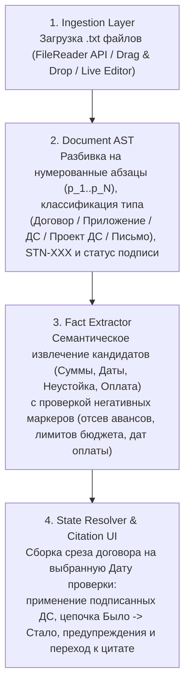

# Semantic TextNavigator — Прототип сверки условий договоров поставки

## 1. Установка, запуск и примеры использования

### Назначение и стек
Прототип помогает специалисту по закупкам быстро сверять действующие условия договоров поставки (сумму и срок поставки на выбранную дату проверки), отделять вступившие в силу дополнительные соглашения от неподписанных проектов и писем поставщиков, а также переходить в один клик к точной цитате и абзацу в исходном документе.

Решение выполнено как автономное клиентское веб-приложение (`index.html` + `engine.js`) на стандартном стеке HTML5 / CSS3 / Vanilla JavaScript без внешних библиотек, платных API-ключей и серверных зависимостей.

### Команды установки и запуска
1. **Запуск по веб-ссылке (без установки):** откройте опубликованную ссылку в любом современном браузере (Chrome, Safari, Edge, Firefox).
2. **Локальный запуск из архива или репозитория:**
   - Откройте файл `index.html` двойным кликом в браузере;
   - Либо запустите стандартный локальный веб-сервер из папки проекта:
     ```bash
     python3 -m http.server 8000
     ```
     После чего откройте в браузере адрес `http://localhost:8000`.

### Примеры использования и сценарии проверки
1. **Загрузка документов (кнопки и Drag & Drop):** при открытии приложения стартовый набор из 6 учебных файлов (`documents/01_contract.txt` … `06_amendment_draft.txt`) предзагружен для быстрой демонстрации. Кнопка **`Загрузить .txt файлы`** полностью очищает память и строит таблицу заново по любым выбранным файлам с диска. Кнопка **`+ Добавить файл`** (или перетаскивание файлов мышью на страницу) догружает новый документ в текущий пакет с мгновенным пересчетом таблицы.
2. **Смена даты проверки («Машина времени»):** поле **`Дата проверки`** по умолчанию установлено на `10.03.2026`. Если переключить дату на `20.02.2026 (до ДС №1)`, система пересчитает юридическую силу документов: поскольку ДС № 1 к договору `STN-101` вступает в силу `01.03.2026`, на `20.02.2026` в таблице автоматически восстановятся базовые условия (`1 200 000 руб.` и срок `15.04.2026`), а ДС № 1 перейдет в блок сведений о будущих изменениях.
3. **Проверка оснований и цитат:** клик по любой сумме, дате, зачеркнутому прежнему значению, документу пакета или предупреждению открывает справа исходный файл, прокручивает текст к целевому абзацу в центр экрана и подсвечивает точную цитату.
4. **Неустойка (п. 4.1) и автопроверки:** кнопка **`+ Неустойка (п. 4.1)`** включает колонку со ставкой неустойки и ее расчетом в рублях за день просрочки, а кнопка **`Автотесты (14)`** открывает модальное окно с прогоном 14 проверочных сценариев.

### Эталонный результат сверки на 10.03.2026 (по 6 учебным файлам)

| Договор | Поставщик | Действующая сумма | Действующий срок поставки | Сведения для проверки и отсеянные ловушки |
| :--- | :--- | :--- | :--- | :--- |
| **STN-101** | ООО «Вектор Прибор» | **1 380 000 руб. (с НДС)**<br>*Основание:* `02_amendment_signed.txt`, п. 1 (было `1 200 000 руб.` в `01_contract.txt`, п. 2.1) | **30.04.2026**<br>*Основание:* `02_amendment_signed.txt`, п. 2 (было `15.04.2026` в `01_contract.txt`, п. 3.1) | **Требует внимания:** Проект ДС № 2 (`06_amendment_draft.txt` от 06.03.2026) предлагает `1 450 000 руб.` (+70 000 руб.) и срок `10.05.2026` — **не подписан, не действует**.<br>*Отсеяна ловушка:* оговорка о дате приемки (п. 3.2). |
| **STN-102** | ООО «Контур Электро» | **840 000 руб. (с НДС)**<br>*Основание:* `03_contract.txt`, п. 2.1 | **20.03.2026**<br>*Основание:* `03_contract.txt`, п. 3.1 | **Требует внимания:** Письмо поставщика (`05_supplier_email.txt` от 05.03.2026) с предложением переноса на `27.03.2026` (+7 дн.) — **согласие не получено, ДС не подписано**.<br>*Отсеяны ловушки:* аванс `252 000 руб.` (п. 2.2) и срок оплаты `10.04.2026` (п. 3.2). |
| **STN-103** | ООО «ПромСнаб Сервис» | **нет данных**<br>*Основание:* `04_contract.txt`, п. 2.1 (отсылка к отсутствующему Приложению № 1) | **30.04.2026**<br>*Основание:* `04_contract.txt`, п. 3.1 | **Требуется проверка:** Приложение № 1 со спецификацией отсутствует в комплекте.<br>*Отсеяна ловушка:* внутренний лимит бюджета покупателя `600 000 руб.` (п. 2.2) не является стоимостью договора. |

### Ответы на 4 контрольных вопроса пользователя (на 10.03.2026)
1. **Какой срок поставки действует по договору STN-101 на 10 марта 2026 года?**
   Действует срок **30.04.2026** на основании подписанного и вступившего в силу `01.03.2026` Дополнительного соглашения № 1 (`02_amendment_signed.txt`, п. 2). Первоначальный срок `15.04.2026` (`01_contract.txt`, п. 3.1) изменен, а предложение перенести срок на `10.05.2026` в Проекте ДС № 2 (`06_amendment_draft.txt`, п. 2) не подписано сторонами и не действует.
2. **Какова сумма договора STN-102?**
   Итоговая стоимость договора составляет **840 000 рублей, включая НДС** (`03_contract.txt`, п. 2.1). Указанный в п. 2.2 авансовый платеж (`252 000 рублей`) входит в общую стоимость.
3. **Какова сумма договора STN-103?**
   **нет данных** — согласно п. 2.1 договора (`04_contract.txt`), общая стоимость определяется спецификацией в Приложении № 1, которое не входит в комплект документов. Указанный в п. 2.2 внутренний лимит бюджета покупателя (`600 000 рублей`) согласованной стоимостью договора не является.
4. **По каким договорам поставка запланирована раньше 1 апреля 2026 года и есть ли несогласованные изменения срока?**
   Поставка раньше `01.04.2026` запланирована только по договору **STN-102** — действующий срок **20.03.2026** (`03_contract.txt`, п. 3.1). По этому договору **есть несогласованное изменение срока**: письмо поставщика ООО «Контур Электро» от `05.03.2026` (`05_supplier_email.txt`) с предложением перенести поставку на `27.03.2026` (на `10.03.2026` согласие покупателя не получено, ДС не подписано).

### Известные ограничения и границы применимости подхода
- Прототип работает с текстовыми файлами `.txt` в кодировке UTF-8; распознавание сканов (OCR), парсинг сложных таблиц в PDF/DOCX и свободный диалоговый чат в объем задания не входят.
- Выбранный подход на базе детерминированных семантических правил и регулярных паттернов оптимален для ограниченного числа корпоративных шаблонов (типовые договоры компании, стандартные допсоглашения, спецификации и уведомления). При переходе к тысячам произвольных внешних форм контрагентов со свободной версткой правила необходимо дополнить гибридным конвейером (структурированное извлечение через LLM с обязательной валидацией цитаты по исходному тексту).

---

## 2. Продуктовая записка

### Для какого пользователя сделан прототип
**Пользователь:** специалист по закупкам (контрактный менеджер, куратор договоров поставки в ООО «СеверМет»).
**Рабочий сценарий:** перед согласованием заявки на оплату, формированием плана приемки на складе или выставлением претензии поставщику закупщику нужно за 20–30 секунд увидеть актуальные обязательства по договору на конкретную дату. Главная ценность продукта для него — защита от дорогих операционных ошибок (оплата по неподписанному проекту ДС, пропуск просрочки из-за путаницы между датой поставки и датой постоплаты, принятие внутреннего бюджетного лимита за твердую цену контракта) и возможность мгновенно показать руководителю или юристу первоисточник каждой цифры.

### Пять вопросов клиенту перед развитием решения
1. **Интеграция с источниками правды о статусе документа:** откуда в реальном процессе система должна забирать достоверный статус подписания документа — из метаданных оператора ЭДО (Диадок / СБИС, штамп УКЭП), из карточки согласования в СЭД/ECM или из реестра в 1С:ERP, если в самом тексте реального файла нет строки «Статус: подписан»?
2. **Глубина детализации спецификаций:** достаточно ли закупщику сводной суммы и единого срока по договору в целом, или в промышленной версии нужно разбирать табличные Приложения-спецификации с графиком частичных отгрузок и ценами по каждой номенклатурной позиции?
3. **Сценарий реакции на несогласованные изменения:** какое целевое действие должен совершить закупщик прямо из интерфейса при обнаружении письма о переносе срока или неподписанного проекта ДС (отправить задачу на согласование в СЭД, сформировать карточку риска просрочки или автоматически рассчитать размер неустойки по п. 4.1)?
4. **Обработка рамочных договоров и заказов:** какая доля закупок идет по твердым разовым договорам, а какая — по рамочным договорам, где цена и срок фиксируются в сотнях ежемесячных заказов/спецификаций?
5. **Требования информационной безопасности и контура развертывания:** содержат ли договоры коммерческую тайну и персональные данные (152-ФЗ), требующие строго локального развертывания (On-Premise) без передачи текстов во внешние облачные LLM?

### Принятые допущения
- **Связывание документов по содержанию, а не по имени файла:** принадлежность документа к сделке определяется извлечением номера договора (`STN-XXX`) из тела текста. Имена файлов, даты в названиях и порядок загрузки на приоритет не влияют.
- **Поатрибутное применение изменений (Field-level Inheritance):** подписанное обеими сторонами дополнительное соглашение, вступившее в силу не позднее даты проверки, обновляет только те атрибуты (`Сумма`, `Срок` или `Неустойка`), которые явно изменены в его тексте, сохраняя остальные условия базового договора. Если в силу вступило несколько ДС, они применяются последовательно по дате вступления в силу и номеру ДС.
- **Строгий приоритет отсутствия данных над догадками:** если стоимость не названа числом и отсылает к отсутствующему документу, выводится `«нет данных»`. Числа с маркерами аванса, внутреннего лимита бюджета или даты расчетов отсеиваются в справочный слой отфильтрованных условий.
- **Явная маркировка неоднозначностей (`«Требуется проверка»`):** если в пакете есть неподписанный проект ДС, письмо с предложением переноса, ссылка на отсутствующее приложение, неясный статус подписания или коллизия дат вступления в силу, система не меняет подтвержденные цифры в основных колонках, но выводит явный сигнал необходимости ручной проверки с цитатой.

### Две метрики полезности и качества
1. **Метрика продуктовой полезности — Среднее время верификации договора (`Time-to-Verify`):**
   - *Как считается:* медианное время от момента выбора договора закупщиком до подтверждения действующих условий с переходом к цитате-основанию.
   - *Целевой ориентир:* сокращение времени сверки одного договорного пакета с 10–12 минут ручного поиска по файлам до 15–30 секунд (ускорение в 20+ раз).
2. **Метрика качества и надежности — Точность подтвержденного извлечения (`Grounded Extraction Accuracy`):**
   - *Как считается:* доля проверочных полей (`Сумма`, `Срок`, `Статус изменений`), в которых одновременно совпали с эталоном: (а) само значение или статус `«нет данных»`, (б) учет даты проверки и (в) точный абзац-основание, при **0% ложных срабатываний** на числах-ловушках (авансах, бюджетных лимитах, датах оплаты, неподписанных черновиках).

---

## 3. Архитектура, масштабирование до 100 000 документов и план развития

### Схема и описание архитектуры прототипа
Приложение построено по модульной четырехслойной схеме (`engine.js` + `index.html`) без жесткого зашивания данных под конкретные файлы:



### Три ключевых технических решения и их компромиссы

| Техническое решение | Обоснование и плюсы | Компромисс и границы применимости |
| :--- | :--- | :--- |
| **1. Детерминированный семантический парсер вместо вызова облачной LLM** | Дает 100% предсказуемость, отсутствие галлюцинаций на числах, мгновенный отклик без сети и запуск у интервьюера без API-ключей и затрат на токены. | Требует поддержки словаря маркеров при появлении новых юридических формулировок; на неструктурированных внешних договорах должен дополняться LLM-экстрактором. |
| **2. Хранение каждого факта в связке с координатами источника (`Fact + Citation Span`)** | Ни одно число в системе не существует отдельно от объекта `{value, fileName, paragraphId, quote}`. Это исключает «выдуманные» цифры и обеспечивает переход к абзацу в 1 клик. | Увеличивает объем метаданных на каждое поле, но полностью решает задачу трассируемости и аудита для закупщика и юриста. |
| **3. Динамический пересчет состояния (`State Resolver`) поверх неизменяемого лога фактов** | Базовый договор и все ДС хранятся как цепочка событий. Срез рассчитывается на лету под выбранную «Дату проверки», сохраняя цепочку «Было -> Стало» и список отклоненных черновиков. | При тысячах документов пересчет на стороне браузера станет узким местом — на большом объеме расчет состояния переносится в фоновый воркер и БД. |

### Что изменится при 100 000 документов и наличии прав доступа
При масштабировании до корпоративного архива в 100 000+ документов и внедрении ролевой модели доступа архитектура трансформируется в пятиуровневую серверную платформу (в том числе с поддержкой On-Premise развертывания):

1. **Асинхронный конвейер ввода и распознавания (Ingestion Queue & IDP/OCR):**
   Входящие файлы из СЭД/ЭДО/почты поступают через очередь сообщений (Kafka / RabbitMQ) в воркеры парсинга (PDF, DOCX, сканы через OCR) со структурной разбивкой документа на разделы, пункты и таблицы спецификаций.
2. **Граф связей документов и материализованный срез в БД (PostgreSQL + Redis):**
   Парсить 100 000 текстов на лету нельзя. В PostgreSQL хранится **граф связей документов** (`Договор <- ДС <- Спецификации <- Письма`) и таблица предрассчитанных актуальных состояний договоров (`Materialized Contract State`), которая событийно обновляется при поступлении нового документа. Частые выборки и агрегации кэшируются в Redis.
3. **Гибридный поиск и двухконтурное извлечение (Hybrid Search + Verified LLM):**
   - Для поиска по 100 000 документов используется гибридный индекс: полнотекстовый поиск (**BM25 / Elasticsearch** — точный поиск по номерам договоров, ИНН, датам и суммам) + векторный поиск (**Vector DB + Embeddings** — поиск по смыслу нетиповых формулировок) + **Reranker**.
   - Для извлечения фактов из нетиповых договоров подключается локальная или корпоративная LLM в режиме **Structured Outputs (JSON Schema)**, а за ней — детерминированный скрипт-верификатор, который проверяет точное вхождение вернувшейся цитаты в исходный абзац документа.
4. **Архитектура прав доступа (RBAC / ABAC) и защита целостности данных:**
   - **Предварительная фильтрация (Pre-Query ACL Filtering):** метаданные прав доступа (юрлицо, подразделение, категория закупок, список допущенных ролей из Active Directory / Keycloak) присваиваются каждому документу и каждому индексному чанку. Фильтр прав доступа применяется на уровне поискового движка и БД **до** выполнения векторного поиска и **до** формирования контекста для LLM.
   - **Защита от ложной актуальности при конфликте прав (Partial Access Guard):** критический сценарий — у закупщика есть доступ к базовому договору `STN-101`, но нет прав доступа к закрытому ДС № 1, которое изменило сумму. Система не имеет права ни показать закрытую сумму из ДС № 1, ни выдать устаревшую сумму базового договора за актуальную. В этом случае поле маркируется статусом: *«Условие изменено документом с ограниченным уровнем доступа (обратитесь к владельцу договора)»*, а все попытки чтения фиксируются в журнале аудита (Audit Log).

### Три следующих улучшения в порядке приоритета
1. **Приоритет 1. Извлечение штрафных условий и параметров оплаты (п. 4.1 — ставка неустойки, лимит пеней, авансы и отсрочка):** добавление в таблицу колонки ответственности поставщика с цитатой и автоматическим расчетом суммы начисляемой неустойки при нарушении срока поставки (реализовано в прототипе по кнопке Расширенного режима).
2. **Приоритет 2. Парсинг форматов DOCX/PDF и табличных Приложений № 1 (Спецификаций):** автоматическое извлечение итоговой стоимости и поэтапных сроков из приложенных таблиц спецификаций, чтобы закрыть пробелы «нет данных» по договорам типа `STN-103`.
3. **Приоритет 3. Пакетный экспорт в Excel/1С и генератор карточек расхождений:** выгрузка проверенного реестра договоров в один клик и формирование готового текста ответа поставщику при получении писем о несогласованном переносе сроков.

---

## 4. Краткий отчет о вайбкодинге

### Использованный инструмент
Проектирование логики, генерация кода и отладка проверочных сценариев выполнялись с помощью ИИ-инструментов разработки **Google Antigravity (Gemini)** и **DeepSeek Harness**.

### Характерные запросы к ИИ (Промпты)
1. **Постановка правил предметной области и разрешения коллизий:**
   > *«Спроектируй движок сверки условий договоров поставки на чистом JS без хардкода имен файлов. Вход: произвольный набор `.txt` файлов и дата проверки `checkDate`. Алгоритм должен: 1) связывать файлы по номеру договора `STN-XXX` в тексте; 2) классифицировать документ (базовый договор, приложение-спецификация, подписанное обеими сторонами ДС, неподписанный проект ДС, письмо поставщика); 3) применять изменения суммы и срока поатрибутно только из тех подписанных ДС, у которых дата вступления в силу `<= checkDate`; 4) неподписанные проекты и письма выводить отдельно в блок сведений для проверки»*.
2. **Защита от семантических ловушек и выдуманных значений:**
   > *«Напиши модуль извлечения стоимости и срока поставки с жесткой защитой от ложных срабатываний. Если стоимость указана отсылкой к отсутствующему приложению — возвращай строго "нет данных". Добавь семантический фильтр негативного контекста: не принимать за стоимость договора сумму аванса и внутренний лимит бюджета покупателя; не принимать за срок поставки дату окончательной оплаты или оговорку о дате приемки. Все отфильтрованные числа сохраняй с цитатой в массив отклоненных ловушек для прозрачности проверки»*.
3. **Интерактивная трассировка цитат и автотестирование:**
   > *«Собери двухпанельный интерфейс: слева — таблица договоров и 4 быстрых фильтра по контрольным вопросам закупщика, справа — просмотрщик исходного документа с нумерацией абзацев и встроенным редактором для лайв-проверки. При клике на любую сумму, срок, старую редакцию или предупреждение — открывай нужный файл, прокручивай к абзацу и подсвечивай точную цитату. Добавь модуль автопроверок на 14 тест-кейсов для самодиагностики парсера»*.

### Пример ошибки ИИ и способ проверки / исправления
- **Ошибка ИИ:** в первой версии генерации парсер извлекал суммы и даты по простым регулярным выражениям (`/\d[\d\s]*рублей/` в разделе 2 и `/\d{2}\.\d{2}\.\d{4}/` в разделе 3), а также содержал жесткую текстовую заглушку в объяснении ответа на Вопрос № 3. На проверочном прогоне обнаружились три проблемы:
  1. В договоре `STN-103` ИИ подтянул в таблицу сумму `600 000 руб.` из п. 2.2 (внутренний лимит бюджета покупателя) вместо `«нет данных»`.
  2. В договоре `STN-102` ИИ взял последнюю дату в разделе 3 — `10.04.2026` из п. 3.2 (срок оплаты оставшейся суммы) вместо реального срока поставки `20.03.2026` из п. 3.1.
  3. При тестовой догрузке Приложения № 1 с ценой к договору `STN-103` сумма в таблице обновлялась, но текст пояснения в карточке Вопроса № 3 продолжал писать, что приложение отсутствует.
- **Способ проверки и исправления:** для верификации был написан набор из 14 автоматических проверок (включая симуляцию загрузки новых договоров, обратный порядок загрузки файлов и догрузку спецификации к `STN-103`). В экстрактор добавлена двухуровневая проверка контекста предложения (позитивные маркеры обязательства + фильтр стоп-маркеров аванса, лимита и срока оплаты), а генератор ответов на вопросы переведен на универсальную сборку текста от фактического состояния поля. Повторный прогон автотестов в браузерном движке подтвердил результат `14/14 PASS`.

### Фактические затраты времени и оставшиеся задачи
- **Затраченное время:** **2 часа 45 минут** (30 минут — разбор документов и крайних случаев; 1 час 30 минут — разработка, отладка и автотестирование прототипа; 45 минут — оформление документации `README.md`).
- **Оставшиеся задачи:** подключение серверного парсера для форматов `.docx/.pdf` (включая табличные спецификации), сохранение пользовательских резолюций закупщика в базу данных и прямая выгрузка в 1С:ERP по API.
